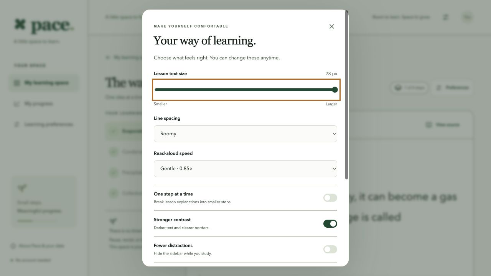
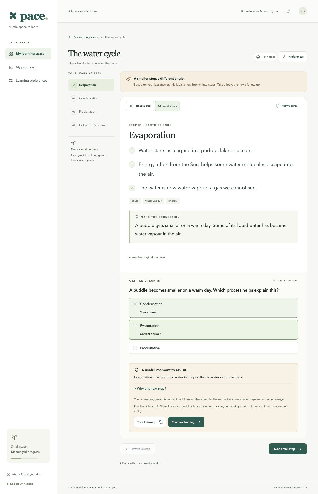
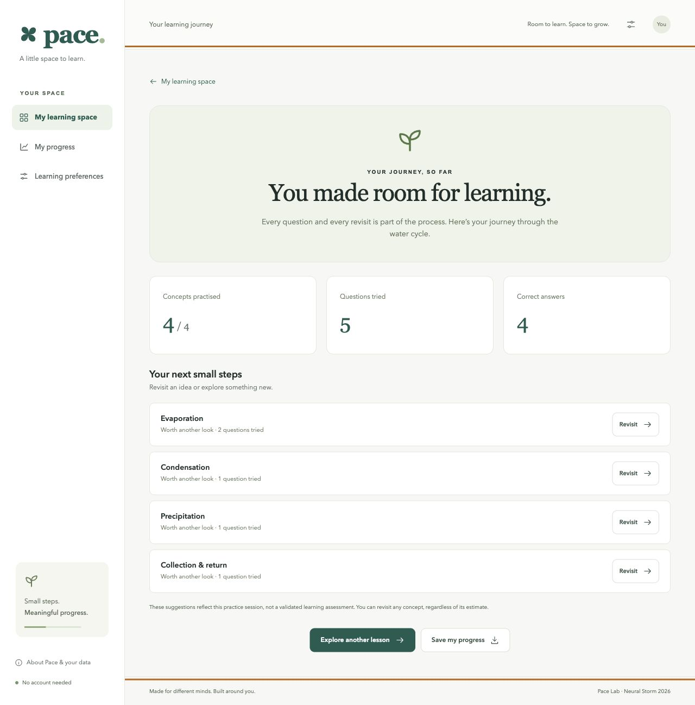
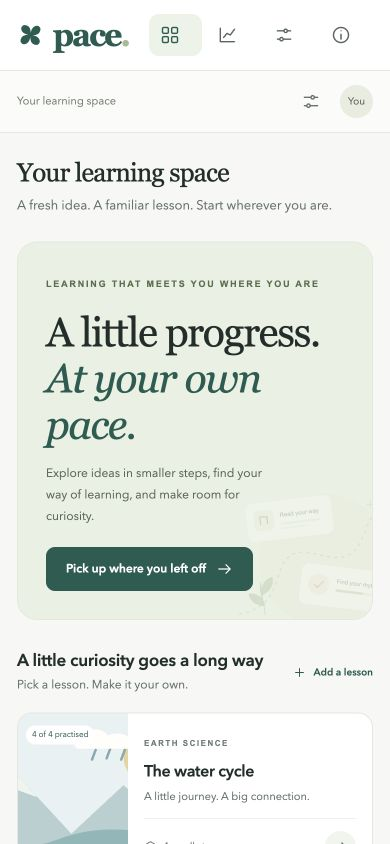

# Pace · A little progress, at your own pace

Pace lets learners choose a comfortable reading format and responds to practice answers with smaller steps, visible sources and an explained next step.

  

**[Live demo → Open Pace](https://pace-neural-storm.onrender.com)** 
Free hosting: the first load may take about a minute to wake, which is normal.

**Swayam Bangad (solo) · HI-03 Adaptive Learning for Students with Disabilities · Neural Storm 2026**

**Tech stack:** FastAPI · scikit-learn TF-IDF · Bayesian Knowledge Tracing · vanilla JS · Render

[Documentation and evidence index](docs/README.md)

## Contents

- [Why Pace](#why-pace)
- [Try it in three minutes](#try-it-in-three-minutes)
- [Why not just an LLM?](#why-not-just-an-llm)
- [How practice adapts](#how-practice-adapts)
- [Run locally](#run-locally)
- [Project structure](#project-structure)
- [Validation](#validation)
- [Screenshot gallery](#screenshot-gallery)
- [Data and privacy](#data-and-privacy)
- [Future work](#future-work)
- [AI assistance and provenance](#ai-assistance-and-provenance)

## Why Pace

Dense, fixed-format lessons can create access barriers for some learners.

Asha is a fictional learner working through the water cycle. She chooses larger text and more spacing. 
When she answers “Condensation” for a drying puddle, Pace shows the explanation in smaller steps. 
She checks the original source, reads why the next activity was suggested, and tries a different question. 
She can also continue manually; there is no timer or reading-speed score.

| Access barrier | What Pace provides | Evidence boundary |
| --- | --- | --- |
| A long passage feels difficult to work through | One concept at a time, optional smaller steps and extractive processing of pasted English notes | Local NLP keeps source wording; it does not rewrite difficult vocabulary |
| Losing track of the lesson | A concept outline, revisit controls and browser-saved practice when enabled | No account synchronization |
| Small text or poor contrast | 16–28 px lesson text, three spacing settings and stronger contrast | A complete contrast/zoom audit remains pending |
| Difficulty using a mouse | Native buttons, radio groups, skip link and keyboard focus management | A water-cycle keyboard journey was completed; switch access was not tested |
| Screen-reader use | Semantic headings/landmarks, labelled controls and a live feedback region | Semantic structure alone does not establish assistive-technology compatibility |
| Cannot hear narration | Explanations, sources, questions and feedback remain visible as text | Narration is optional; text and practice do not depend on audio |

This is a prototype of supported practice, not a validated assessment or a clinical tool.

## Try it in three minutes

No login, sign-up or evaluation credentials are required.

1. Open **The water cycle**. In **Preferences**, increase text size or spacing; leave smaller steps off initially.
2. For the drying-puddle question, choose **Condensation**, then **Check my understanding**.
3. Notice the smaller-step explanation. Open **Why this next step?** and **View source**.
4. Select **Try a follow-up**, then answer **A gas**. You can always continue manually.
5. Use **Add a lesson** with your own English passage: at least 35 words, two complete sentences and no more than 24,000 characters.
6. Open **My progress**, revisit a concept or export the practice record as JSON.

Three prepared science lessons are available immediately. Pasted lessons are labelled **Local text analysis**, keeping them distinct from prepared content and optional cloud generation.

## Why not just an LLM?

The default design needs no API key, model download or paid model service. It extracts representative source sentences and creates source-word recall practice on the app's Python server; student text is not sent to a third-party AI by default. Practice recommendations have an inspectable reason, and the learner can inspect the original source or choose another pace. An optional cloud-AI adapter exists for richer rewritten explanations, but it is **verified only with mocked tests**; a live provider call and its teaching quality remain unverified. Source-word recall can have weak distractors, so teacher review is still needed.

## How practice adapts

An incorrect answer requests smaller steps; correct answers request reinforcement or a recommendation to advance. The learner remains in control.

Bayesian update, parameters and worked example

For each concept, the prior is **p = 0.20**, guess **g = 0.25**, slip **s = 0.10**, learning transition **t = 0.15**, and advance threshold **0.80**.

~~~text
Correct:   posterior = p(1-s) / [p(1-s) + (1-p)g]
Incorrect: posterior = ps / [ps + (1-p)(1-g)]
next_p = posterior + (1-posterior)t
~~~

The actual [adaptation code](app/adaptation.py) uses **round(..., 4)**: it rounds to four decimal places rather than truncating. Recomputed with that code, two correct answers from the prior give **0.5526 → 0.8439**, recommending **reinforce → advance**. An incorrect answer followed by a correct answer gives **0.1774 → 0.5215**.

After each answer, the updated probability is rounded to four decimal places, and that rounded probability is used as the prior for the next answer.

The hand-selected parameters are uncalibrated. A fixed guess rate simplifies questions with differing option counts and difficulty. The estimate is neither an ability percentage nor proof of mastery. Each question is scored once per saved session.

## Run locally

Requires **Python 3.12** and a modern browser. The documented installation was tested with Python 3.12.14 on macOS arm64. Node is needed only for JavaScript developer tests.

~~~sh
python3 -m venv .venv
source .venv/bin/activate
python -m pip install -r requirements.lock
python -m uvicorn app.main:app --host 127.0.0.1 --port 8000
~~~

Open [http://127.0.0.1:8000](http://127.0.0.1:8000). On Windows, activate with **.venv\Scripts\activate**. No .env file is needed for the default experience. Use the lockfile for the verified versions.

~~~sh
python -m pip install -r requirements-dev.txt
python -m pytest -q
node --test tests/frontend.test.cjs
python -m scripts.evaluate
python -m scripts.evaluate_questions
~~~

The evaluation commands write [the historical grounding/timing report](docs/evaluation.json) and [the question-diagnostic report](docs/evaluation_questions.json) with actual run timestamps. [Deployment instructions](docs/DEPLOYMENT.md) cover the Python service and optional container configuration. The [CI workflow](.github/workflows/ci.yml) defines Python 3.12 and Node 24 test jobs. The existing test badge reports local results; it is not a CI badge.

## Project structure

~~~text
app/                  Python APIs, local NLP, prepared lessons and adaptation
static/               Browser library, reader, preferences and practice
tests/                Python and JavaScript regression tests
scripts/evaluate.py   Reproducible local grounding/timing checks
scripts/evaluate_questions.py  Question leakage and distractor diagnostics
docs/                 Evidence, rules, demo script and screenshots
requirements.lock     Verified runtime dependency versions
Dockerfile            Optional container configuration
render.yaml           Render deployment configuration
~~~

## Validation

**Current local suite: 43 Python + 21 JavaScript tests pass**, rerun on November 5, 2026. One upstream Starlette/httpx deprecation warning remains. The November 5 application polish and documentation/measurement changes were verified locally before publication; the hosting row below records checks of the November 4 deployment. The test badge reports local results, not CI status.

| Check | Recorded result |
| --- | --- |
| Prepared lessons | Browser QA completed all three lessons and ten concepts |
| Keyboard journey | Water cycle completed using Tab, arrows, Space and Enter, including incorrect/correct practice and the summary |
| Responsive layouts | Library and reader measured at 320, 360, 768, 1280 and 1600 px without page-level horizontal overflow; a separate 390 px capture is included |
| Saved state | Draft choices, source view, preferences and current concept survived reload in the documented checks |
| Public hosting | HTTPS demo verified on November 4: wrong-answer scaffolding, source/why disclosures, correct follow-up, preferences/reload and custom lesson generation; health checks returned 200 |
| Optional cloud adapter | Mocked contract tests only; no live-provider verification |

The historical November 3 generator report used three original development passages, five runs each, on the development Mac:

| Passage | Concepts | Quote grounding (by construction) | Question grounding (by construction) | Median generation |
| --- | ---: | ---: | ---: | ---: |
| Water cycle | 4 | 4/4 | 11/11 | 1.83 ms |
| Plant energy | 4 | 4/4 | 11/11 | 1.61 ms |
| Electricity | 5 | 5/5 | 9/9 | 1.57 ms |

The 13/13 source quotes, 13/13 extractive summaries and 31/31 restored source-word questions are **grounding checks that hold by construction**: the generator selects source spans/sentences and blanks a word from a selected sentence. They can catch implementation regressions, but do not establish question quality, model accuracy, hosted latency or improved learning.

Question diagnostics were measured on November 5 across all generated questions from the three sample passages plus the original gravity demo input:

| Input | Questions | Answer-leak rate | Ambiguity proxy | Neither POS nor length matches |
| --- | ---: | ---: | ---: | ---: |
| The water cycle | 11 | 1/11 (9.09%) | 8/11 (72.73%) | 0/33 (0.00%) |
| How plants make food | 11 | 0/11 (0.00%) | 10/11 (90.91%) | 2/33 (6.06%) |
| A spark of electricity | 9 | 0/9 (0.00%) | 6/9 (66.67%) | 7/27 (25.93%) |
| Demo gravity passage | 8 | 2/8 (25.00%) | 6/8 (75.00%) | 0/24 (0.00%) |
| **Total** | **39** | **3/39 (7.69%)** | **30/39 (76.92%)** | **9/117 (7.69%)** |

Leakage means the blanked answer still occurs as a whole word anywhere in the prompt. The ambiguity proxy flags a question when any distractor occurs in the same concept's quote; source co-occurrence does not prove that it is another correct answer. The last column is per distractor, not per question: both its crude word-class guess differs from the answer's and its length differs by more than two characters. The word-class heuristic uses a declared verb list, suffix rules and a noun-like fallback; it is not a contextual POS tagger.

These development-set diagnostics show limitations rather than educational accuracy. The [full JSON](docs/evaluation_questions.json) includes definitions, denominators, individual prompts, source quotes and every distractor; reproduce it with `python -m scripts.evaluate_questions`. No poor cases are filtered out.

**Known limits**

- Not verified: actual 200% zoom or physical phones.
- Not verified: audible narration across devices or independent Chrome/Firefox/Safari runs.
- Not verified: every failure/contrast state, hosted load behavior or learning outcomes.

[Detailed QA](docs/POLISH_REPORT.md), [keyboard/persistence follow-up](docs/archive/READINESS.md) and [hosted verification](docs/DELIVERY_STATUS.md) contain the methods and limits. Earlier results are retained in [the build log](docs/BUILD_LOG.md).

## Screenshot gallery

Real local app captures; the summary contains QA practice, not learner-study results. Narrow views use viewport emulation.

| Reading preferences | Explained next step |
| --- | --- |
|  |  |

| Practice summary | Mobile layout |
| --- | --- |
|  |  |

[All screenshots and capture notes](docs/screenshots/README.md)

## Data and privacy

- No account, diagnosis, camera or microphone is required. Optional narration may use browser/device voice services, including remote voices.
- Remembering stores lesson text, preferences and attempts in this browser. Turning it off removes the saved copy while the current in-memory session can continue. Nothing syncs across devices. JSON export is a record, not an importable backup.
- Pasted text is processed by the app server, including when hosted. The app has no lesson database and does not intentionally log request bodies; hosting infrastructure may keep request metadata.
- Optional cloud mode sends the title and passage to the configured provider only after selection. Its key stays on the server. Browser storage is not encrypted application storage; the demo is not intended for sensitive student records.

## Future work

- Test with real students, teachers and accessibility specialists, including real screen-reader sessions.
- Calibrate Bayesian parameters and assess recommendations with consented data.
- Add and evaluate multilingual lessons.
- Have teachers review generated questions and improve distractors and conceptual assessment.
- Verify a live cloud-provider path and review its output quality.
- Add optional accounts with secure cross-device synchronization while retaining account-free access.

## AI assistance and provenance

Codex was used for implementation, original sample content drafting, interface illustrations, debugging, test development, evaluation and documentation. The solo participant is Swayam Bangad; AI assistance is disclosed rather than counted as a human team member. No other AI assistant or external runtime AI provider was used in the tested default path.

Original prepared lessons are labelled as prepared; local NLP is extractive rather than generative. Visuals use code-native SVG and CSS. The source is available under the [MIT license](LICENSE).

Built Nov 3-4, 2026 with Codex assistance; see docs/BUILD_LOG.md for dated records.
