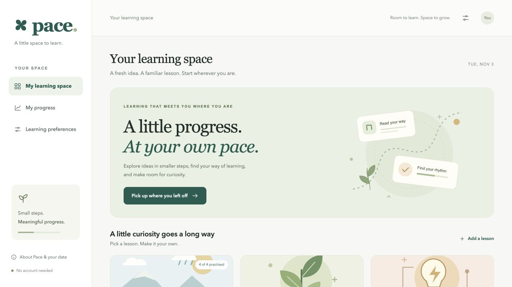
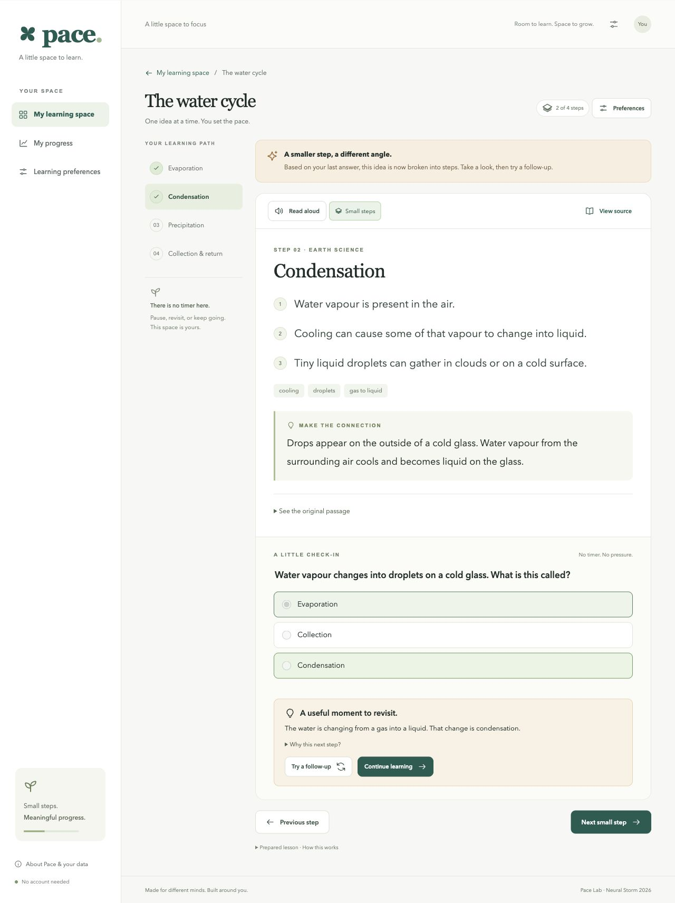

# Pace · A little progress, at your own pace

**Neural Storm 2026 · Human Impact · HI-03: Adaptive Learning for Students with Disabilities**  
**Registered team:** Swayam Bangad (solo) · **Participant:** Swayam Bangad · **Project label:** Pace Lab

**Public repository:** [SXShadow/pace-neural-storm](https://github.com/SXShadow/pace-neural-storm). Participant and registered team names were verified against the event dashboard on November 4; earlier planning records retain the spelling originally supplied.

**Submission kit:** [start here](docs/START_HERE.md) · [current form answers](docs/FORM_ANSWERS.md) · [judge Q&A](docs/JUDGE_QA.md) · [screenshot guide](docs/screenshots/README.md).

**Delivery update, November 4:** the complete code is published in the public repository above. The Neural Storm dashboard confirmed the project submission, and the saved repository link remained visible after reload. Optional hosting and video are still pending. See the [earlier readiness checks](docs/READINESS.md) for scoped verification and limitations.

**November 4 polish update:** 38 Python tests and 7 JavaScript tests pass. See the [detailed audit and remaining manual checks](docs/POLISH_REPORT.md) and [2½-minute Asha demo script](docs/ASHA_DEMO.md). The earlier November 3 results below are retained as historical evidence. Run JavaScript unit tests with **node --test tests/frontend.test.cjs** (Node is only needed for these developer tests). Code is available under the [MIT license](LICENSE).

Pace is a learning companion that turns a short lesson into a manageable path, lets learners control its presentation, and responds to practice answers with smaller steps or a recommendation to move forward. The complete default experience runs without an AI account, API key, model download, or paid service.

## The problem and our approach

A dense lesson, fixed presentation, and timed questions can create barriers for learners who need a different reading format or interaction pace. Pace focuses on adjustable reading and keyboard interaction for students with reading, attention, visual, or motor access needs. Learners choose preferences directly; the app does not infer or ask for a diagnosis.

The key interaction is visible: answer a question incorrectly, see the explanation broken into smaller steps, read the source, then try a different question. The learner remains free to move on or revisit a concept. This is a prototype for supported practice, not a validated assessment or a claim to support every disability.

## Try it in three minutes

1. Open **The water cycle** from the learning space.
2. Use **Preferences** to change text size, line spacing, contrast, or focus mode.
3. Answer the evaporation question incorrectly. Pace shows smaller steps and explains its recommendation.
4. Select **Try a follow-up** and answer the new question.
5. Open **View source** to check the original passage.
6. Add a lesson using your own English teaching passage (35+ words and at least two sentences).
7. Visit **My progress** or finish the lesson to see an honest practice record. Export it as JSON.

There is no countdown, speed scoring, sign-up, camera, or microphone. The sample lessons contain original prepared explanations; they are clearly labelled. New pasted lessons are processed by the Python NLP pipeline.

## Run locally

Requires **Python 3.12** and a modern browser. Tested with Python 3.12.14 on macOS arm64. Node.js is not required to run or build the app.

~~~sh
python3 -m venv .venv
source .venv/bin/activate
python -m pip install -r requirements.lock
python -m uvicorn app.main:app --host 127.0.0.1 --port 8000
~~~

Open **http://127.0.0.1:8000**. On Windows, activate with **.venv\Scripts\activate**. No .env file is needed for the default experience.

For development, append **--reload** to the server command. The preview used during development runs on port 8765.

### Tests and reproducible evaluation

~~~sh
python -m pip install -r requirements-dev.txt
python -m pytest -q
python -m scripts.evaluate
~~~

The evaluation rewrites [docs/evaluation.json](docs/evaluation.json) with the actual run timestamp, environment, timings, source-fidelity checks, and adaptation sequences.

## What works

| Capability | Implementation |
| --- | --- |
| Accessible reading controls | 16–28 px lesson text, three line-spacing settings, high contrast, smaller steps, reduced-distraction view |
| Keyboard interaction | Skip link, semantic controls, native dialogs, radio question groups, focus after feedback and navigation |
| Optional narration | Browser speech synthesis with speed control and stop; text remains available |
| Personal lessons | English passage processing with TF-IDF ranking, extractive explanations, source quotes, word-recall questions |
| Adaptive practice | Python Bayesian Knowledge Tracing updates a per-concept estimate and recommends scaffold, reinforce, or advance |
| Transparent feedback | Answer explanation, source passage, and “Why this next step?” disclosure |
| Progress | Browser-local lessons and attempts, reload persistence, JSON export, clear-data confirmation |
| Optional cloud generation | Explicit opt-in adapter for a configured compatible provider, with schema and source-quote validation |

## Architecture

~~~text
Browser: HTML + CSS + JavaScript
  |-- preferences, lessons and practice history in localStorage
  |-- optional narration via browser/device voice service
  |
  +-- FastAPI Python server
        |-- prepared original lessons
        |-- scikit-learn TF-IDF local lesson generation
        |-- Bayesian practice update
        +-- optional HTTPS AI provider (only when enabled and selected)
~~~

One process serves the UI and API. There is no frontend bundler, database, vector database, or account service.

- [app/nlp.py](app/nlp.py): sentence grouping, TF-IDF centroid ranking, keywords, extractive summaries, cloze questions.
- [app/adaptation.py](app/adaptation.py): the practice model and recommendation policy.
- [app/provider.py](app/provider.py): optional provider adapter.
- [app/main.py](app/main.py): typed API, request checks, generation concurrency, security headers.
- [static/app.js](static/app.js): reader, navigation, accessible feedback, preferences, persistence and export.
- [tests/test_pace.py](tests/test_pace.py): API, generation, adaptation, and provider contract tests.

### Three content modes, clearly distinguished

**Prepared samples:** three original lessons about the water cycle, plant energy, and simple circuits. Explanations, examples and questions are prepared content. They make the demo repeatable.

**Local NLP (default):** the app groups source sentences, ranks representative sentences using TF-IDF and cosine similarity, and creates source-word recall questions. Explanations are extractive: the words come from the source. It does not train a neural model or promise to simplify difficult vocabulary. Distractors are source terms and may be pedagogically weak.

**Optional cloud AI:** a compatible provider can produce rewritten explanations and questions. Structured output and exact source quotes are validated. Matching a source quote does not prove every generated claim is correct. A teacher or learner should review generated material. Cloud failures are reported, not silently replaced with a fake result.

### How practice adapts

For each concept, the model starts with probability **p = 0.20**. With guess **g = 0.25**, slip **s = 0.10**, and learning transition **t = 0.15**:

~~~text
Correct answer:
  posterior = p(1-s) / [p(1-s) + (1-p)g]

Incorrect answer:
  posterior = ps / [ps + (1-p)(1-g)]

After either observation:
  next_p = posterior + (1-posterior)t
~~~

An incorrect answer requests **scaffold** (smaller steps and another question). A correct answer below 0.80 requests **reinforce**. A correct answer at or above 0.80 requests **advance**. Two distinct correct answers from the initial prior produce 0.5526, then 0.8439. An incorrect answer followed by a correct one produces 0.1774, then 0.5215.

Parameters are hand-selected and uncalibrated. Questions have different difficulty and may have different numbers of options; the fixed guess rate is an illustrative simplification. The estimate is not a percentage of intelligence, a diagnosis, or proof of mastery. The UI describes practice and recommendations rather than asserting learning gains. Each question is scored only once per saved session.

## Actual validation results

Latest checks, November 4, 2026: **38 Python tests and seven JavaScript tests pass**. All three prepared lessons were completed; a fresh water-cycle journey was completed using only Tab, arrow keys, Space and Enter. Duplicate custom input preserved its answered question, and reload restored the current concept, open source view and scroll position at the tested viewport. Library and reader measurements at 320, 360, 768, 1280 and 1600 px showed no page-level horizontal overflow. Fresh dependency installation and a clean source-copy test run passed. See [the readiness record](docs/READINESS.md) for limits, including unverified screen-reader output, actual 200% zoom, audible narration, physical phones and independent browser runs.

Recorded November 3, 2026:

- **28 automated tests passed**; one upstream Starlette/httpx deprecation warning.
- Python package dependency check passed.
- JavaScript syntax check passed.
- Browser checks covered lesson creation, wrong/correct practice, distinct follow-up, all four water-cycle concepts, summary, persistence, preferences, skip link, source disclosure, and a downloaded JSON export.
- Responsive library and reader checks at **390 px** showed no page-level horizontal overflow after a reader grid fix.
- No console errors or warnings appeared in the inspected browser logs.

Local generator evaluation: three original sample passages, five runs per passage on this development machine:

| Passage | Generated concepts | Quotes found in source | Grounded source-word questions | Median generation |
| --- | ---: | ---: | ---: | ---: |
| Water cycle | 4 | 4/4 | 11/11 | 1.83 ms |
| Plant energy | 4 | 4/4 | 11/11 | 1.61 ms |
| Electricity | 5 | 5/5 | 9/9 | 1.57 ms |

All 13 generated summaries also matched source text. These are small, in-process functional checks on development examples, **not an external benchmark, model accuracy, hosted latency, or evidence of improved learning**. The optional cloud adapter has mocked contract tests; no live provider call has been verified. Docker and public hosting have not yet been verified.

See [accessibility and QA notes](docs/ACCESSIBILITY.md) for tested behaviour and remaining limitations.

## Data and privacy

- No diagnosis, disability profile, identity, email, or account is required.
- Remembering progress stores lesson text, preferences and attempts in this browser. Turning it off removes the saved copy; the current session can continue in memory. Export is a record, not an importable backup.
- Default lesson generation sends text to this app's server. When hosted, “local NLP” means processing on that hosting server, not entirely on the learner's device. The app has no lesson database and does not intentionally log request bodies; infrastructure may retain request metadata.
- Cloud mode sends the lesson title and passage to the configured provider only after explicit selection. The key stays on the server.
- Narration uses browser/device voice services, which may be remote depending on the selected voice.
- The demo is not intended to store sensitive student records. Browser storage is not encrypted application storage.

## Deployment and submission

[Deployment guide](docs/DEPLOYMENT.md) includes Render and Docker instructions. [Demo script](docs/DEMO_SCRIPT.md) and [submission text](docs/SUBMISSION.md) are ready for review.

**Current delivery status:** public code repository and event submission confirmed on November 4. Downloaded the published source ZIP and verified all 52 files against the local submission source; all Python and JavaScript tests passed on that copy. A verified hosted URL and demo recording remain pending. The event form accepted the required repository URL with optional links blank.

## AI assistance and provenance

Codex was used for implementation, original sample content drafting, interface illustrations, debugging, test development, evaluation and documentation. The solo participant is Swayam Bangad; AI assistance is disclosed rather than counted as a human team member. No other AI assistant or external runtime AI provider was used in the tested default path.

During GitHub publication, GitHub's web editor also auto-suggested the message for one file-creation commit. That suggestion affected commit wording, not application implementation or runtime generation.

Open-source libraries include FastAPI, Pydantic, scikit-learn, NumPy, SciPy, Uvicorn, httpx and pytest. The default implementation uses TF-IDF and Bayesian inference rather than a pretrained LLM. Visuals are code-native SVGs and CSS; no stock photos or generated raster assets are required.

[NEURAL_STORM_BRIEF.md](NEURAL_STORM_BRIEF.md) records earlier rule interpretation and conceptual discussion. [Build log](docs/BUILD_LOG.md) distinguishes those advance notes from implementation on November 3. No dates or commit history have been manufactured.

## Reference documentation

- [scikit-learn text feature extraction](https://scikit-learn.org/stable/modules/feature_extraction.html)
- [FastAPI static files](https://fastapi.tiangolo.com/tutorial/static-files/)
- [MDN browser speech synthesis](https://developer.mozilla.org/en-US/docs/Web/API/SpeechSynthesis)
- [W3C accessibility principles](https://www.w3.org/WAI/fundamentals/accessibility-principles/)
- [W3C guidance on clear content](https://www.w3.org/WAI/WCAG2/supplemental/objectives/o3-clear-content/)

Sample passages are original educational text; background reference links appear in each prepared lesson. Accessibility design references do not constitute a conformance certification.

